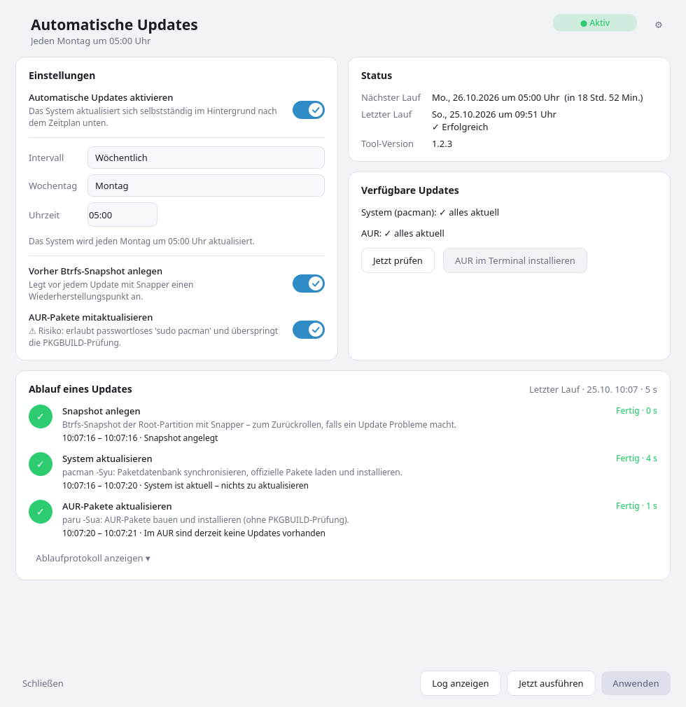
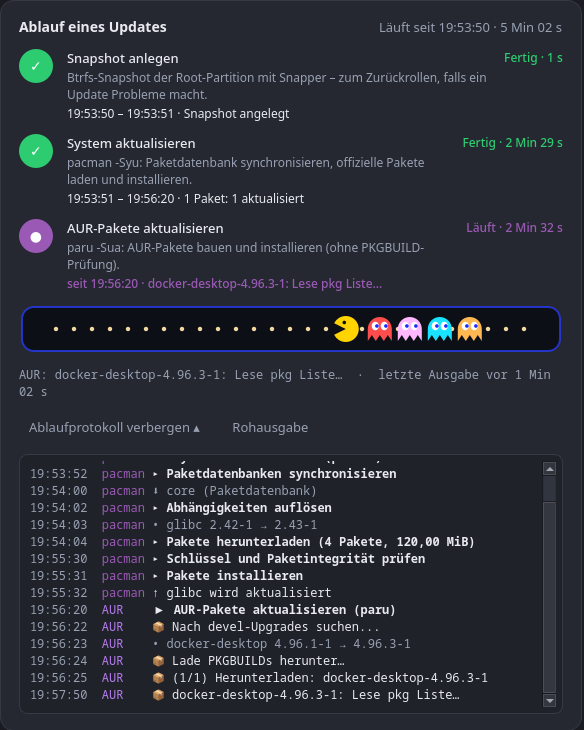
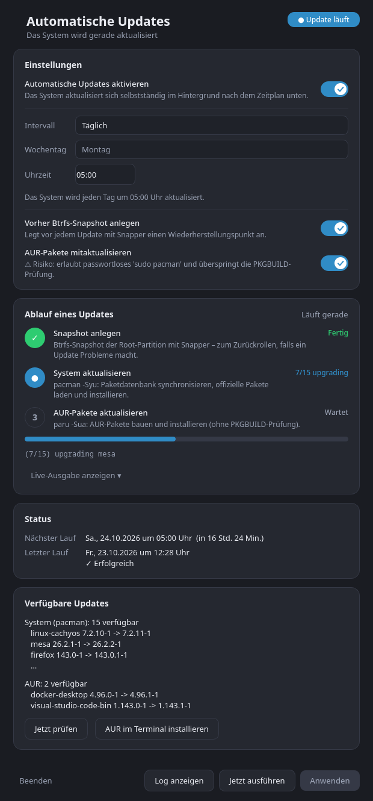
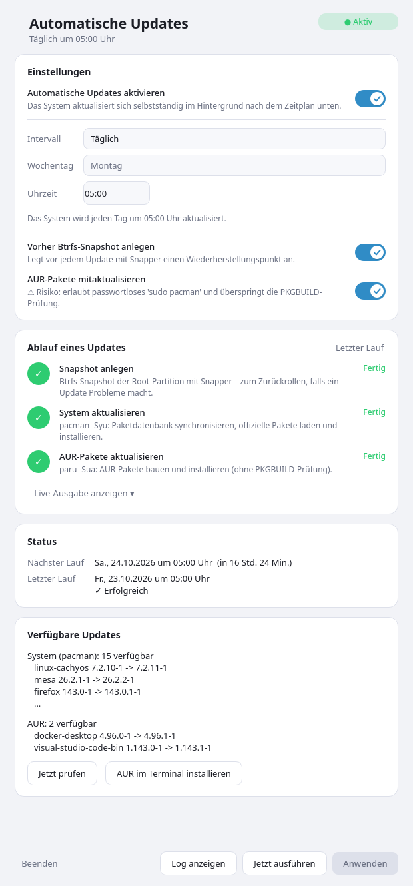

# 🔄 auto-update-gui

Moderne Qt6-Oberfläche für automatische Systemupdates unter Arch Linux und Arch-Derivaten (getestet auf CachyOS).
Man sieht jederzeit, **was** das Tool gerade tut – und es ersetzt das Cachy-Update-Tray-Applet.

<p align="center">
  
</p>

<p align="center">
  
</p>

<p align="center">
  
  &nbsp;
  
</p>

## Features

- **Zeitplan** per systemd-Timer: täglich, wöchentlich oder 5 Min. nach dem Start – läuft auch nachts ohne Login,
  weckt den Rechner aus dem Standby (`WakeSystem`), verhindert Standby während des Updates und holt
  verpasste Läufe nach dem nächsten Start nach (`Persistent`)
- **Btrfs-Snapshot** mit Snapper vor jedem Update (optional)
- **AUR-Updates** über paru (optional, mit Sicherheitshinweis)
- **Ablaufanzeige** Snapshot → pacman → AUR mit Start-/Endzeit und Dauer pro Schritt, aktueller Tätigkeit
  („Lade herunter 12/20 · mesa“, „AUR: docker-desktop · Lese pkg Liste …“) und „letzte Ausgabe vor …“
- **Ablaufprotokoll** mit Uhrzeit pro Ereignis: was wann heruntergeladen, installiert und gebaut wurde (pacman und AUR getrennt); Standardansicht ist die Rohausgabe, umschaltbar auf ausgewertete Ereignisse (Auswahl wird gemerkt)
- **Systemerkennung** (Arch, CachyOS, EndeavourOS, Garuda, Manjaro, BlackArch, Artix): Dialog „System & Quellen“ mit erkannter Distribution, Repos, CPU-Stufe (x86-64-v2/v3/v4) und Hinweisen zu Zusatzquellen (CachyOS-Repos, Chaotic-AUR, BlackArch) – nur Info und Anleitung, es wird nichts automatisch eingetragen. Das Mirror-Werkzeug passt sich an (cachyos-rate-mirrors oder reflector, Manjaro: keins)
- **Mirrors**: Status (zuletzt bewertet, nächste automatische Bewertung des CachyOS-Timers) und Knopf „Mirrors jetzt aktualisieren“ (nutzt `cachyos-rate-mirrors`, Sicherung als `*-backup`)
- **Sicherheitsprüfung** mit `arch-audit`: zeigt installierte Pakete mit bekannten Lücken (CVE), Schweregrad und ob ein Fix verfügbar ist; Hinweis im Tray bei neuen Fixes (abschaltbar)
- **Download-Fortschritt in Echtzeit** (auch wenn pacman nichts ausgibt): MiB, Prozent, Geschwindigkeit, Restzeit und die gerade ladenden Pakete – gelesen aus dem pacman-Cache
- **Pac-Man** als Fortschrittsanzeige 👾: frisst Punkte und Geister, jagt sie bei unbestimmter Dauer; im Leerlauf „READY!“, nach dem Lauf „LEVEL CLEAR“ oder bei Fehlern „GAME OVER“
- **Systray** mit Update-Zähler als Badge und Benachrichtigung; Check alle 3 Stunden
- Responsives Layout: breit = Einstellungen links, Status und verfügbare Updates rechts, Ablauf darunter; schmal = eine Spalte
- Animierte Switches, Karten-Layout; **Einstellungen** (⚙ im Fenster oder Tray-Menü): Farbschema hell/dunkel/System,
  Akzentfarbe, Prüfintervall, Benachrichtigungen, Autostart – alles live umschaltbar
- **Selbst-Update:** prüft GitHub-Releases; bei neuer Version erscheint ein Hinweis mit Knopf „Jetzt aktualisieren“
  (Passwortabfrage via `pkexec`, danach Neustart der GUI)
- Startet beim Login automatisch im Tray (`--tray`); „Schließen“ minimiert nur ins Systray, komplett beenden über Rechtsklick auf das Tray-Icon → „Verlassen“

## Installation

Direkt aus Git:

```bash
git clone --depth 1 https://github.com/peter1965p/auto-update-gui.git
cd auto-update-gui && sudo ./install.sh
```

Updates des Tools selbst kommen danach über das Tray-Menü („Nach Tool-Update suchen“ / „Tool auf vX aktualisieren“)
oder den Hinweis im Fenster. Deinstallieren: `sudo ./uninstall.sh`.

Benötigt: `python-pyqt6`, `git`, `curl`, `pacman-contrib` (checkupdates), optional `snapper`, `paru`, `arch-audit` (Sicherheitsprüfung) und `cachyos-rate-mirrors` (Mirror-Knopf, nur CachyOS).

`install.sh` deaktiviert zusätzlich Tray-Applet und Timer von Cachy-Update (`arch-update`) für den
aufrufenden Benutzer. Rückgängig:

```bash
rm ~/.config/autostart/arch-update-tray.desktop
systemctl --user enable --now arch-update.timer
```

## Aufbau

| Datei | Zweck |
|---|---|
| `files/auto-update-gui` | Qt6-Oberfläche + Systray |
| `files/auto-update-run` | vom systemd-Service ausgeführt: Snapshot, `pacman -Syu`, AUR |
| `files/auto-update-apply` | schreibt Konfiguration und Timer (via `pkexec`) |
| `files/auto-update-self` | holt einen Release-Tag von GitHub und installiert ihn (via `pkexec`) |
| `files/auto-update.{service,timer}` | systemd-Units |

Optionen der GUI: `--tray` (ohne Fenster starten), `--theme=dark|light`.

## Releases

Die Versionsnummer steht in `files/auto-update-gui` (`VERSION`). Neue Version veröffentlichen:

```bash
# VERSION im Skript erhöhen, committen, dann:
git tag v1.1.0 && git push --tags
gh release create v1.1.0 --notes "Was ist neu"
```

Die GUI vergleicht den neuesten Release-Tag mit `VERSION`. Die Prüfung funktioniert nur, wenn das Repo öffentlich ist.
