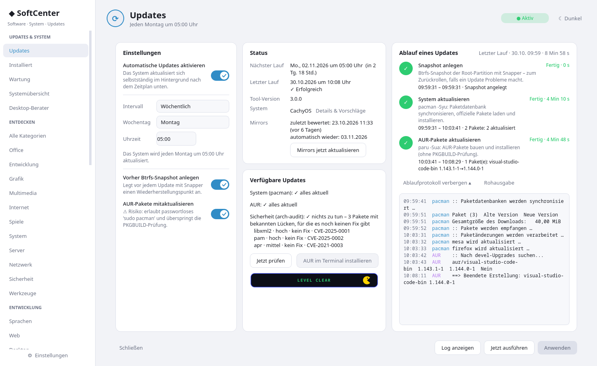
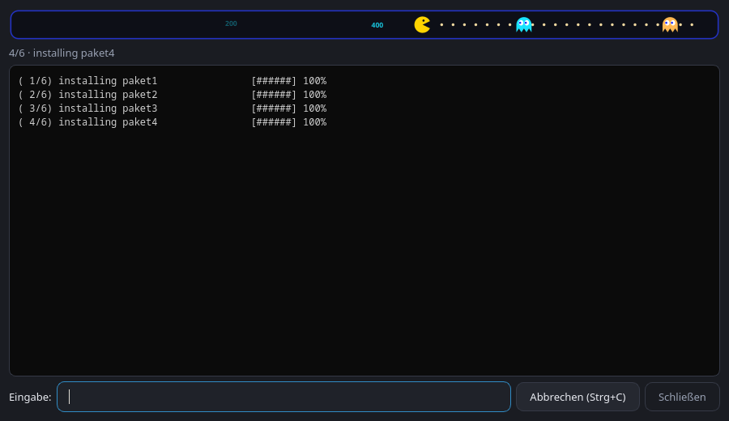

# 🧰 SoftCenter

**Software, System und Updates an einem Ort** für Arch Linux und Arch-Derivate (getestet auf CachyOS).
Qt6-Oberfläche mit Seitenleiste: Software finden und installieren, Installiertes sehen und sauber entfernen,
das System verwalten und automatische Updates planen – und bei allem sehen, was gerade passiert.

<p align="center">
  
</p>
<p align="center">
  
  &nbsp;
  
</p>

## Was es kann

### Updates
- **Zeitplan** per systemd-Timer: täglich, wöchentlich oder nach dem Start – auch nachts ohne Login,
  weckt den Rechner aus dem Standby und verhindert Standby während des Updates; verpasste Läufe werden nachgeholt.
- **Ablauf:** optional Btrfs-Snapshot (Snapper) → `pacman -Syu` → optional AUR (paru).
- **Ablaufanzeige** mit Start, Ende und Dauer pro Schritt, aktueller Tätigkeit, Download-Fortschritt in Echtzeit
  (MiB, Prozent, MiB/s, Restzeit) und einem Ablaufprotokoll mit Uhrzeiten (Rohausgabe oder ausgewertet).
- **Sicherheitsprüfung** mit `arch-audit` (CVE, Schweregrad, Fix verfügbar; Warnung nur, wenn es einen Fix gibt).
- **Ausnahmeliste:** Pakete, die der automatische Lauf überspringen soll (pacman und paru, `--ignore`). Am fehlgeschlagenen AUR-Schritt gibt es dazu einen Knopf „Paket künftig überspringen“.
- **Mirrors:** Status und Knopf „Mirrors jetzt aktualisieren“ (`cachyos-rate-mirrors` oder `reflector`, je nach System).
- **Systray** mit Update-Zähler, Benachrichtigungen und Autostart; ersetzt Cachy-Update.

### Software
- **Suche** in Repo und AUR, Kategorien und **kuratierte Sammlungen** (Entwicklung, Office, Spiele …),
  einzeln oder komplett installierbar.
- **Installieren und Entfernen im eingebetteten Terminal** (Passwort- und Rückfragen funktionieren).
- **Update-Regel:** Gibt es offene Updates, fragt die App vor dem Installieren „erst aktualisieren?“ (keine Teil-Updates).
- **Sicheres Entfernen:** Vorher eine Vorschau, was alles mit entfernt würde. Wird ein Paket noch gebraucht, sagt die App von wem.
  Systemkritische Pakete sind geschützt.

### System und Wartung
- **Systemübersicht:** Hardware, installierte Desktops, **installierte Sammlungen** – jeweils mit „Entfernen“.
- **Desktop-Berater:** bewertet KDE, GNOME, Xfce, Hyprland & Co. nach Profil und Hardware.
- **Wartung:** verwaiste Pakete, Paket-Cache, `.pacnew`-Dateien, fehlgeschlagene Dienste, Flatpak.
- **Systemerkennung** (Arch, CachyOS, EndeavourOS, Garuda, Manjaro, BlackArch, Artix) mit Hinweisen zu Zusatzquellen.

### Und sonst
- **Pac-Man** 👾 als Fortschrittsanzeige: bei Updates und Installationen frisst er Punkte und Geister nach dem
  echten Fortschritt („READY!“, „LEVEL CLEAR“, „GAME OVER“).
- Helles/dunkles Theme, Akzentfarbe, responsives Layout (bis zu drei Spalten).
- **Selbst-Update** über GitHub-Releases (Hinweis und ein Klick, mit Passwortabfrage).

## Installation

```bash
git clone --depth 1 https://github.com/peter1965p/auto-update-gui.git
cd auto-update-gui && sudo ./install.sh
```

Benötigt: `python-pyqt6`, `git`, `curl`, `pacman-contrib` (checkupdates); optional `snapper`, `paru`/`yay`,
`arch-audit`, `cachyos-rate-mirrors` oder `reflector`, `pacman-contrib` (`paccache`).
`install.sh` deaktiviert Tray-Applet und Timer von Cachy-Update (`arch-update`) für den aufrufenden Benutzer (nur wenn vorhanden).
Entfernen: `sudo ./uninstall.sh`. Start: Menü → **SoftCenter**, oder `auto-update-gui`.

Ohne die Root-Teile (Timer, Dienst) lässt sich die App auch nur als Software-Center nutzen; die Update-Automatik
richtet `install.sh` ein.

## Aufbau

| Pfad | Zweck |
|---|---|
| `files/auto-update-gui` | Startskript (findet das Paket) |
| `files/softcenter/` | Python-Paket: `window` (Seitenleiste, Terminal), `updates`, `software`, `maintenance`, `pages` (System), `backend`, `catalog`, `desktops`, `pacbar`, `common` (Theme, Einstellungen) |
| `files/auto-update-run` | vom systemd-Service ausgeführt: Snapshot, `pacman -Syu`, AUR |
| `files/auto-update-apply` | schreibt Konfiguration und Timer (via `pkexec`) |
| `files/auto-update-self` | holt einen Release-Tag von GitHub und installiert ihn (via `pkexec`) |
| `files/auto-update.{service,timer}` | systemd-Units |

Optionen: `--tray` (ohne Fenster starten), `--theme=dark|light`.

## Releases

Die Versionsnummer steht in `files/softcenter/common.py` (`VERSION`). Neue Version veröffentlichen:

```bash
# VERSION erhöhen, committen, dann:
git tag v3.1.0 && git push --tags
gh release create v3.1.0 --notes "Was ist neu"
```

Das Selbst-Update vergleicht den neuesten Release-Tag mit `VERSION`.

## Herkunft

Die Software-Seiten stammen aus dem früheren Projekt *SoftCenter* (PySide6) und wurden hier auf PyQt6 übernommen.
